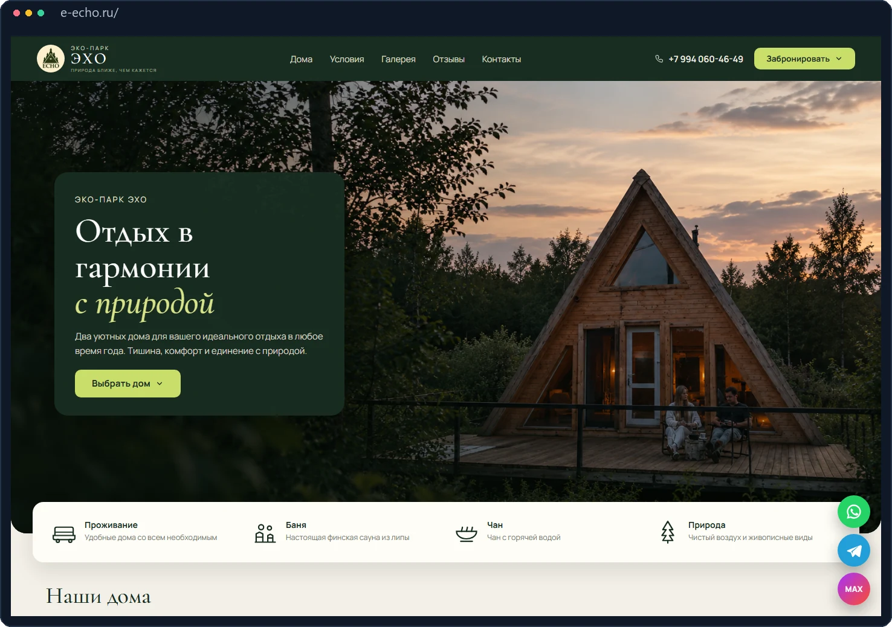
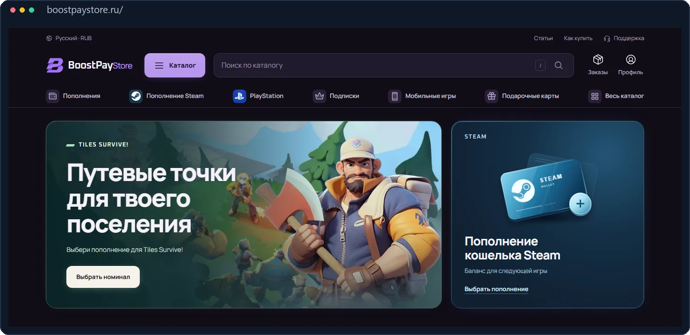
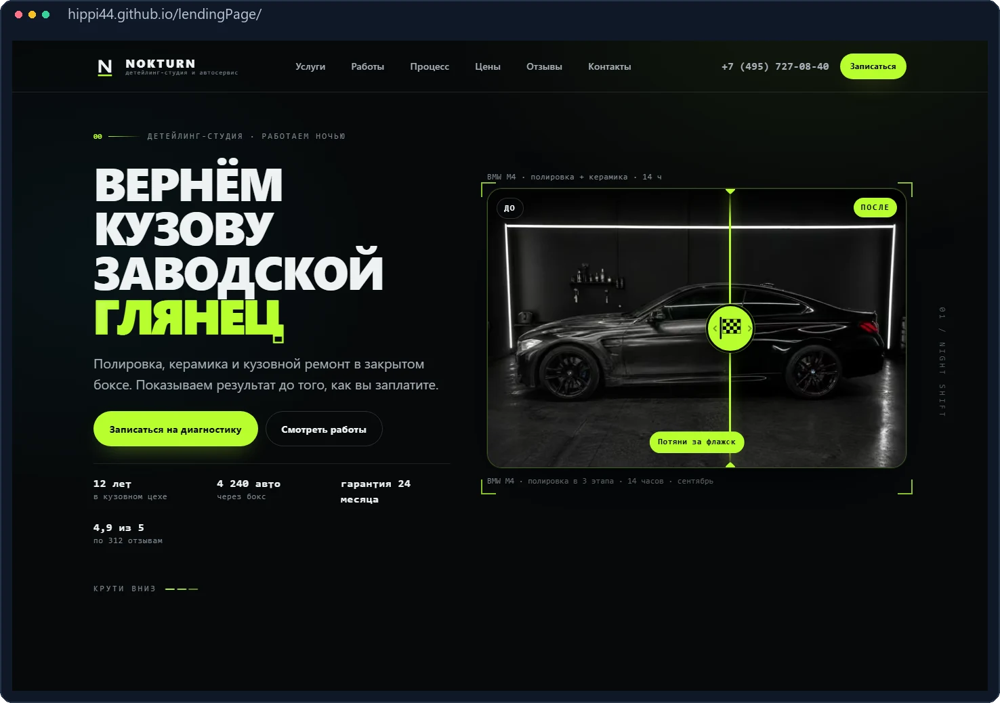
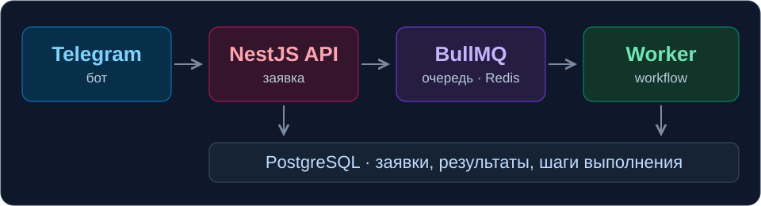
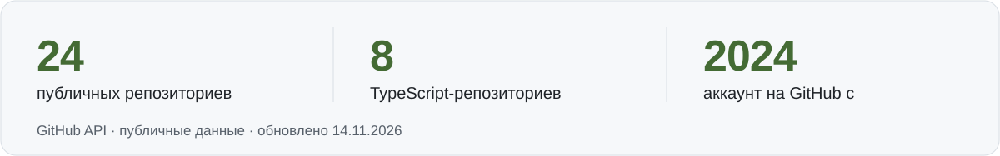

# Hippilokkery

**Fullstack-разработчик.** Пишу веб-приложения на React и Node.js, делаю Telegram-ботов и автоматизацию.

 

## Biba VPN

Мой VPN-сервис с ботом в Telegram. Подключение, тарифы и поддержка — в **[@BibaVPN_bot](https://t.me/BibaVPN_bot)**.

Связаться со мной по поводу проекта: [@Hippilokkery](https://t.me/Hippilokkery).

## Проекты

### Эко-парк «Эхо» · e-echo.ru

Сайт эко-парка с отдельными страницами домов A-Frame и «Усадьба», фотогалереей и видеообзорами. Условия проживания и бронирования, отзывы и связь через мессенджеры.

HTML · CSS · JavaScript

[Открыть e-echo.ru](https://e-echo.ru/)

### BoostPayStore · boostpaystore.ru

Магазин пополнений, подписок и цифровых товаров для игр. Каталог с поиском и фильтрами, карточки игр и сервисов, личный кабинет, статьи и поддержка. В интерфейсе можно выбрать язык и валюту.

Next.js · React

[Открыть boostpaystore.ru](https://boostpaystore.ru/)

### NOKTURN

Лендинг детейлинг-студии с фотографиями «до/после», галереей, фильтрами работ и выбором тарифов. Слайдер работает с мышью, касаниями и клавиатурой. Формы проверяются на клиенте; анимации учитывают `prefers-reduced-motion`.

HTML · CSS · JavaScript · Pointer Events

[Код](https://github.com/Hippi44/lendingPage) · [Сайт](https://hippi44.github.io/lendingPage/)

### Automation System

Telegram-бот собирает заявку и отправляет её в API. Задачи обрабатываются через BullMQ, а заявка, результат и шаги workflow сохраняются в PostgreSQL. Есть повторные попытки и защита от повторного создания заявки.

TypeScript · NestJS · PostgreSQL · Prisma · Redis · BullMQ · Docker

[Код](https://github.com/Hippi44/automation-system) · [Запуск](https://github.com/Hippi44/automation-system/blob/main/README.md)

### Web-Larёk

Магазин с React-интерфейсом и API на Express. Регистрация и JWT-авторизация, управление каталогом, загрузка изображений. Товары хранятся в MongoDB; сервер проверяет состав и сумму заказа.

React · TypeScript · Express · MongoDB · Mongoose · JWT

[Код: `review-admin`](https://github.com/Hippi44/web-larek-express/tree/review-admin)

### Stellar Burgers

Конструктор бургеров с выбором ингредиентов, оформлением заказа, профилем и историей заказов. Состояние на Redux Toolkit, данные приходят из внешнего API. Jest-тесты для редьюсеров конструктора и ингредиентов; Playwright-сценарии с HAR-файлами. Авторизация и закрытые маршруты.

React · TypeScript · Redux Toolkit · React Router · Jest · Playwright

[Код: `review`](https://github.com/Hippi44/stellar-burgers/tree/review) · [Тесты](https://github.com/Hippi44/stellar-burgers/tree/review/tests)

## Стек

   

     

  

Prisma · BullMQ · Vite · GitHub Actions · HTML · CSS / SCSS

## GitHub

<picture>
  <source media="(prefers-color-scheme: dark)" srcset="assets/github-metrics-dark.svg">
  <source media="(prefers-color-scheme: light)" srcset="assets/github-metrics-light.svg">
  
</picture>

[Активность](https://github.com/Hippi44?tab=overview) · [Данные статистики](https://github.com/Hippi44/Hippi44/blob/main/assets/github-metrics.json)

## Связаться

Если хотите обсудить проект или предложить сотрудничество, пишите в Telegram: **[@Hippilokkery](https://t.me/Hippilokkery)**.

[Веб-портфолио](https://hippi44.github.io/portfolio/) · [GitHub](https://github.com/Hippi44)
