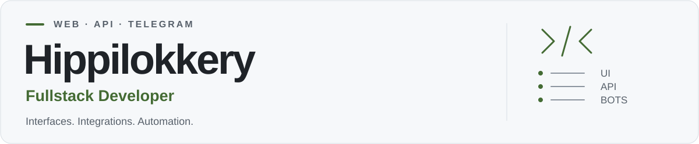

<picture>
  <source media="(prefers-color-scheme: dark)" srcset="assets/header-dark.svg">
  <source media="(prefers-color-scheme: light)" srcset="assets/header-light.svg">
  
</picture>

Разрабатываю **веб-интерфейсы, серверные API и Telegram-интеграции**.
В моих открытых проектах — React и TypeScript, Node.js, базы данных и автоматизация обработки заявок.

 

## Технологии

**Frontend**

   

**Backend и данные**

     

**Инструменты и тестирование**

  

Prisma · BullMQ · Vite · GitHub Actions · HTML · CSS / SCSS

## Избранные проекты

### Automation System

**Обработка заявок через Telegram и событийные workflow.** Демонстрационный контур: бот → API → очередь → обработчик сценариев.
Заявки и журнал выполнения сохраняются в PostgreSQL; реализованы фоновые задачи, повторные попытки и защита от дублирования.

TypeScript · NestJS · PostgreSQL · Prisma · Redis · BullMQ · Docker

[Репозиторий](https://github.com/Hippi44/automation-system) · [Архитектура и запуск](https://github.com/Hippi44/automation-system/blob/main/README.md)

### Web-Larёk · Express API

**Учебный fullstack-проект интернет-магазина.** React-интерфейс и Express API: каталог в MongoDB, JWT-авторизация с обновлением токенов, защищённое управление товарами и загрузка изображений.
Состав и стоимость заказа проверяются на сервере.

React · TypeScript · Node.js · Express · MongoDB · Mongoose · JWT

[Репозиторий](https://github.com/Hippi44/web-larek-express) · [Реализация: `review-admin`](https://github.com/Hippi44/web-larek-express/tree/review-admin)

### Stellar Burgers

**Учебное React-приложение для сборки бургеров.** Состояние конструктора на Redux Toolkit, работа с внешним API, авторизация, защищённые маршруты и история заказов.
В репозитории есть unit-тесты редьюсеров на Jest и браузерные сценарии на Playwright с подменой API через HAR.

React · TypeScript · Redux Toolkit · React Router · Jest · Playwright

[Репозиторий](https://github.com/Hippi44/stellar-burgers) · [Реализация: `review`](https://github.com/Hippi44/stellar-burgers/tree/review) · [E2E-тесты](https://github.com/Hippi44/stellar-burgers/tree/review/tests)

### BoostPay

**Frontend-демо каталога цифровых товаров.** Поиск и фильтры, избранное, личный кабинет и административный интерфейс для управления каталогом и заказами.
Данные и демонстрационная авторизация работают через `localStorage`; серверная авторизация и реальные платежи не подключены.

React · TypeScript · React Router · Vite · CSS Modules

[Репозиторий](https://github.com/Hippi44/boostpay-app) · [Открыть демо](https://hippi44.github.io/boostpay-app/)

### NOKTURN

**Адаптивный лендинг детейлинг-студии без фреймворков.** Интерактивное сравнение «до/после» с управлением мышью, касанием и клавиатурой, галерея на `<dialog>`, фильтры и клиентская валидация формы.
Предусмотрены семантическая разметка и поддержка `prefers-reduced-motion`.

HTML · CSS · JavaScript · Pointer Events · Web Accessibility

[Репозиторий](https://github.com/Hippi44/lendingPage) · [Открыть сайт](https://hippi44.github.io/lendingPage/)

**Ещё один веб-проект:** [Electric Line](https://github.com/Hippi44/ElectricLine) — React-лендинг с Tailwind CSS, анимациями и карточками моделей. [Посмотреть сайт](https://hippi44.github.io/ElectricLine/).

## Мой продукт · Biba VPN

**[Biba VPN — @BibaVPN_bot](https://t.me/BibaVPN_bot)** — мой VPN-сервис с Telegram-ботом: подключение, тарифы и помощь прямо в Telegram.

По вопросам разработки и сотрудничества: **[@Hippilokkery](https://t.me/Hippilokkery)**.

## GitHub · публичный код

<picture>
  <source media="(prefers-color-scheme: dark)" srcset="assets/github-metrics-dark.svg">
  <source media="(prefers-color-scheme: light)" srcset="assets/github-metrics-light.svg">
  
</picture>

Только публичные данные GitHub API. TypeScript учитывается как основной язык репозитория. Карточка обновляется еженедельно при изменении показателей. [Данные](https://github.com/Hippi44/Hippi44/blob/main/assets/github-metrics.json) · [История активности](https://github.com/Hippi44?tab=overview)

## Связаться

Обсудить веб-проект, Telegram-интеграцию или сотрудничество — **[@Hippilokkery](https://t.me/Hippilokkery)**.

[Веб-портфолио](https://hippi44.github.io/portfolio/) · [GitHub](https://github.com/Hippi44)
